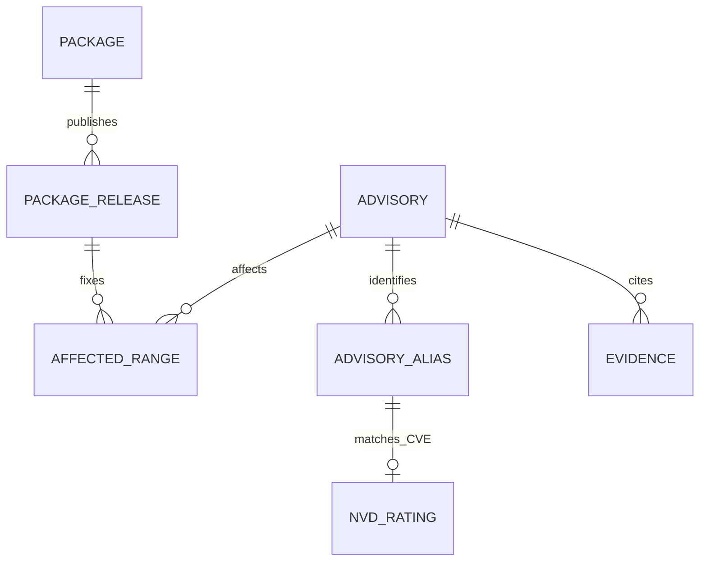

# 方案 G 修订版：PyPI 依赖公告的版本判定与三源核对

## 研究问题与取舍

给定一份固定版本的 Python 依赖清单，如何说明某个版本命中了哪一条公开公告、落在哪段区间，以及可以在哪里复核？作业以此问题串起采集、清洗、关系建模、SQL 和页面演示。保留原方案的 OSV、NVD 与 deps.dev 三个来源，以及 MySQL 8。范围集中在 PyPI，版本顺序统一用 PEP 440。Flask 服务端模板与数据库共用一个云端环境，浏览器直接访问端口 5000。

原方案里的千万行规模、跨生态 CPE 映射、反向依赖图、Scorecard 关联与百万行性能目标均留给扩展实验。本次数据适合检查版本边界和来源一致性，不足以推断开源生态的风险分布。课程若硬性要求百万行或指定 Q6/Q9，仍须补做原实验。

## 数据与实体

2026-11-20 UTC 的固定快照选取 Django、Requests、urllib3 各一条公告，合计三条公告、六段区间。三者各有一个 CVE。Django 的多个维护分支分别给出修复端点，可演示一次公告对应多段区间。NVD 的 CVSS 3.1 数值和 OSV 等级各自保存。NVD 指标优先采用 nvd@nist.gov，元数据中记录实际评分提供方。deps.dev 提供的是修复版发布时间，不能当作补丁编写时间。

| 表 | 主键 | 事实与关系 |
|---|---|---|
| package | name | 规范化 PyPI 包名 |
| advisory | id | OSV 主编号、英文标题、发布和修改时间、等级 |
| advisory_alias | alias_id | 每个样本别名归属于一条公告；冲突引发导入失败供核查 |
| nvd_rating | cve | CVSS 3.1、评分人及修改时间，通过 CVE 与别名匹配 |
| package_release | package_name, version | 修复版发布时间；包与版本一对多 |
| affected_range | advisory_id, package_name, introduced, fixed | 公告与包的多对多关系，并关联修复版 |
| evidence | advisory_id, provider, url | 每条公告的来源链接与采集时间 |

## 查询与演示对应

| 原编号 | 本版问题与实现 | 演示入口 |
|---|---|---|
| Q1 | 指定 PyPI 版本是否落在任一受影响区间，多表连接后按 PEP 440 比较并给出对应修复版本 | 依赖检查 |
| Q2 | 公告编号、CVE 与 PYSEC 别名检索，查看 OSV 区间和 NVD 分数；CPE 对比留待扩展 | 目录与详情 |
| Q3 | 全快照按 OSV 等级计数，用 GROUP BY 与 HAVING；历史样本使用全时期口径 | 公告等级分布 |
| Q4 | 两个来源的 CVE 交集与单边集合，用 NOT EXISTS、外连接与 UNION ALL | CVE 对齐检查 |
| Q5 | 英文标题全文检索，编号走精确条件 | 首页搜索 |
| Q6 调整 | 包按已收录公告的最高 CVSS 排名，用 DENSE_RANK；名次只表示样本最高严重度 | 包的最高评分排名 |
| Q7 | 1–20 行精确依赖一次批量查询，保留原输入顺序，区分包未收录与未命中 | 依赖检查 |
| Q8 | 包内按发布时间展示修复历史，LAG 对照上次收录修复时间 | 修复版本发布历史 |
| Q9 调整 | 按数据源统计可复核链接数、覆盖公告数和最近采集时间 | 三源证据覆盖 |

## 数据工程与验收

1. 采集器按指定公告 ID 读取 OSV，仅接受本版支持的单包 PyPI、已闭合 introduced/fixed 事件。撤回、未闭合区间或格式变化需要复核。按别名 CVE 查询 NVD，按包名和修复版本查询 deps.dev。完整采集后才替换快照。
2. 主外键约束防止孤立区间和来源记录，复合索引支持按包批量检索。日期统一存为 UTC，版本保留原字符串。比较采用左闭右开区间；OSV 的 introduced=0 表示无下界。
3. 数据库导入与页面测试使用同一份快照。验收覆盖重复导入、别名查询、三个维护分支、修复边界、未知包、非法输入和五个统计视图。依赖检查只处理显式固定版本，不解析传递依赖。
4. 若要扩展规模，先扩大固定公告样本并独立采集 NVD 对照集，再对比 EXPLAIN ANALYZE 的实际行数与耗时。本次没有用估算值替代性能实测，也不能用按 OSV 别名采样的三条记录估计 NVD 的全库覆盖率。

## 参考来源

[OSV](https://osv.dev/) · [NVD](https://nvd.nist.gov/) · [deps.dev](https://docs.deps.dev/api/v3/) · [PEP 440](https://peps.python.org/pep-0440/)
